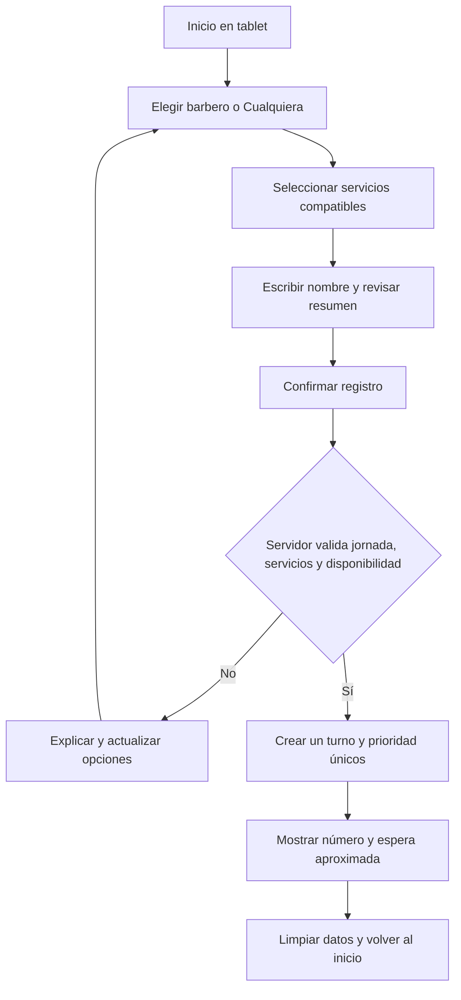
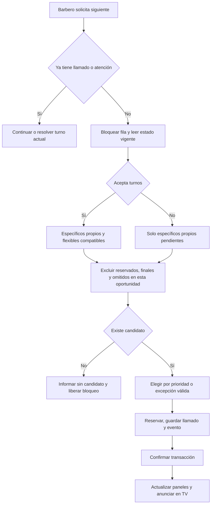
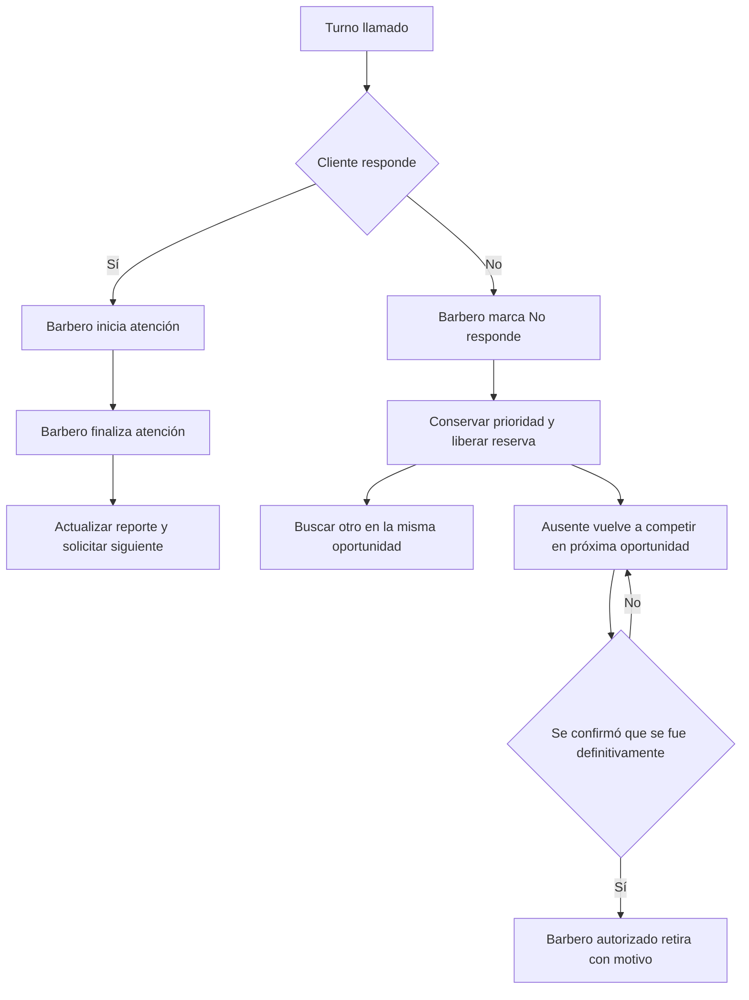
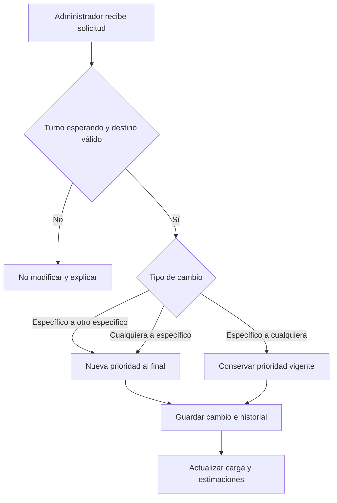
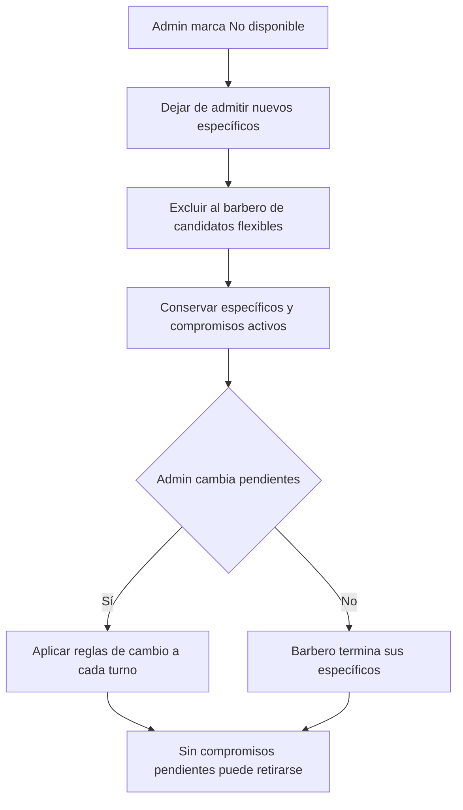
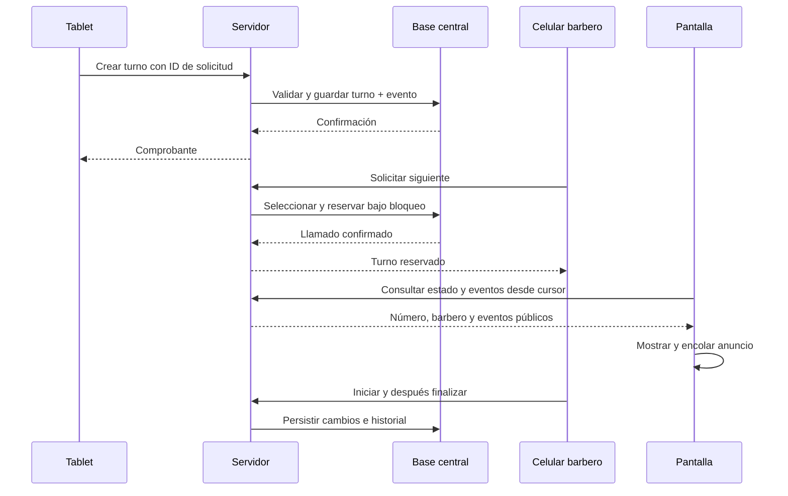

# Flujos de operación

Diagramas Mermaid de comportamiento, sin diseño visual de pantallas. Los pasos técnicos de reserva, oportunidades de llamado y excepción son propuestas de implementación.

## Registro

## Selección del siguiente

## Llamado, ausencia y atención

El ciclo del ausente representa espera de una acción humana o liberación de un barbero; no es un proceso que consume turnos automáticamente.

## Cambios de preferencia

## Cerrar recepción de un barbero

## Coordinación entre dispositivos

El servidor es la autoridad. Ningún celular ni la TV asignan turnos por su cuenta.
