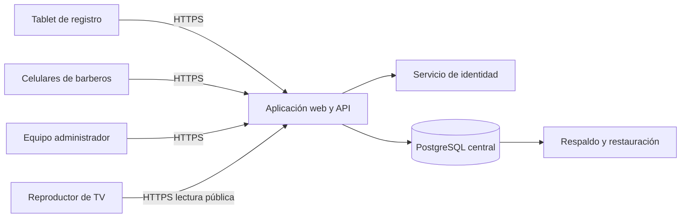

# Arquitectura propuesta

**Estado:** propuesta técnica, sin servicios creados ni código implementado. Las reglas confirmadas siguen en [RN](../01-requisitos/reglas-negocio.md).

## Enfoque

Una aplicación web adaptable, con frontend y API en un mismo proyecto y base de datos central. Es un monolito modular: separa catálogo, turnos, atención, personal, dispositivos y reportes dentro de una sola aplicación. Para una barbería no se justifica comenzar con microservicios.

Propuesta de stack: Next.js/TypeScript, Prisma y PostgreSQL administrado en Neon, con Managed Better Auth para identidad del personal. La API de la aplicación valida roles y reglas antes de consultar datos. La capacidad de alojar UI y endpoints en Next.js se apoya en sus [Route Handlers](https://nextjs.org/docs/app/getting-started/route-handlers).

## Módulos

| Módulo | Responsabilidad |
| --- | --- |
| Identidad y permisos | Sesión del personal, membresías y permisos por operación |
| Catálogo | Servicios, precios, duraciones y capacidades |
| Registro | Validación, numeración, snapshots y comprobante |
| Motor de fila | Elegibilidad, prioridad, reservas, ausencia y cambios |
| Atención | Llamado, inicio, fin y retiro autorizado |
| Administración | Disponibilidad, correcciones, excepciones y jornada |
| Publicación de estado | Vistas filtradas y eventos públicos persistentes |
| Reportes | Agregados de atenciones finalizadas |
| Auditoría | Historial de cambios y decisiones operativas |

Las vistas no contienen una copia independiente del motor de asignación. La misma función de negocio atiende llamadas desde cualquier dispositivo. La simulación de espera reutiliza las reglas sobre una copia de estado, sin reservar turnos reales.

## Sincronización inicial

Propuesta: consultar estado/eventos cada **3 segundos** desde vistas activas, con cursor y versión. Cada escritura actualiza inmediatamente la vista que la solicitó. El objetivo es observar cambios en ≤5 s bajo red estable; se valida en RNF-02.

Con cinco barberos, administrador, tablet y TV, conviene empezar simple. No obstante, diez vistas consultando cada tres segundos durante ocho horas al día por treinta días generan aproximadamente **2,880,000 consultas HTTP al mes**, antes de otras operaciones. Es una estimación de volumen, no de costo. Debe medirse uso de servidor, base de datos y arranques; no asumir que el nivel gratuito cubre producción.

Si las mediciones o la demostración exigen menor latencia/costo, evaluar SSE o un servicio de suscripciones antes de producción. Eso cambia el transporte, no las reglas de negocio. No se incorpora infraestructura de eventos adicional hasta justificarla.

El endpoint de estado entrega una versión consistente; uno de eventos entrega llamados posteriores al cursor. Guardar eventos en base de datos evita perderlos por reinicios del servidor. No depender de un arreglo en memoria ni de mensajes emitidos antes del commit.

## Concurrencia e integridad

Para este volumen, serializar las mutaciones de la fila de una barbería con un bloqueo transaccional sobre su registro de jornada/barbería. Todos los ingresos, llamados, cambios de prioridad, retiros, disponibilidad y configuraciones que alteren elegibilidad respetan ese mismo bloqueo y orden.

Dentro de la transacción: comprobar idempotencia, leer estado, validar permisos/versión, aplicar reglas, reservar o modificar, escribir auditoría/eventos y confirmar. La numeración y las secuencias se generan también dentro de esa protección. No llamar servicios externos ni reproducir voz dentro de la transacción.

La propuesta usa los mecanismos de [bloqueo de PostgreSQL](https://www.postgresql.org/docs/current/explicit-locking.html) y las [transacciones de Prisma](https://www.prisma.io/docs/orm/fundamentals/transactions). Los índices únicos refuerzan invariantes aunque falle una validación de aplicación. No se elige un cliente fuera del bloqueo para reservarlo después.

Una escritura desactualizada devuelve conflicto y obliga a recuperar estado. La disponibilidad y la corrección de servicios se revalidan al confirmar, aunque la pantalla previa mostrara otra cosa.

## Acceso público y privado

- La API es la única vía de acceso a los datos de negocio; los dispositivos no reciben credenciales de PostgreSQL.
- Personal: sesión de identidad más membresía activa en la aplicación. Autenticación por sí sola no autoriza operaciones.
- Tablet: autorización de dispositivo con capacidades mínimas para catálogo/registro.
- TV: autorización de lectura para proyección pública y eventos; sin acceso a datos del cliente.
- Proponer alta de dispositivos con código temporal generado desde administración e intercambio por cookie/token de dispositivo; no usar una clave administrativa permanente en la URL.
- Limitar solicitudes de registro y de acceso, proteger sesiones y validar origen de escrituras según la integración de autenticación elegida.

La identidad administrada propuesta conserva usuarios/sesiones junto al proyecto de datos, según [Neon Auth](https://neon.com/docs/auth/overview). Los roles de negocio se mantienen en tablas de la aplicación, con acceso denegado si no hay membresía.

## Pantalla y sonido

Usar un navegador validado, preferiblemente en reproductor conectado por HDMI. La síntesis de voz puede usar [SpeechSynthesis](https://developer.mozilla.org/en-US/docs/Web/API/SpeechSynthesis); las voces dependen del equipo. Incorporar una acción inicial “Activar y probar sonido”, y probar también la señal de aviso considerando las [restricciones de reproducción automática](https://developer.mozilla.org/en-US/docs/Web/Media/Guides/Autoplay).

Anunciar “Turno A-023, con Fernando”, sin teléfono ni nombre completo. Encolar anuncios simultáneos. El cursor evita repetir eventos procesados; no se promete entrega audible exactamente una vez si el navegador se cierra entre reproducir y guardar el cursor. Un control de repetición manual debe generar un evento de anuncio nuevo, sin reasignar el turno.

## Despliegue e integración

Opción inicial: hosting compatible con Next.js (Vercel como candidato), dominio HTTPS y PostgreSQL administrado. Next.js admite [servidor Node.js o contenedor](https://nextjs.org/docs/app/getting-started/deploying); no usar exportación estática para la API operativa.

Separar demo, desarrollo y producción, con datos y credenciales diferentes. Si se adopta Neon, usar ramas/entornos de desarrollo aislados antes de migraciones. La ubicación del servidor y la base se decide tras medir latencia desde Guatemala y revisar región, plan y compatibilidad de Auth. No se fija proveedor ni suscripción sin revisar las condiciones vigentes.

Registrar variables de entorno y sus responsables sin valores secretos: conexión a base, URL pública, configuración de identidad, secretos de sesión/dispositivos y observabilidad. Las cuentas y dominio de producción deben quedar bajo control acordado con la barbería.

## Fallos y recuperación

| Fallo | Comportamiento previsto |
| --- | --- |
| Tablet pierde red | Mantener selección local de la sesión sin afirmar registro; recuperar por ID de solicitud |
| Celular pierde red | Mostrar desconexión y bloquear mutaciones; al volver, recargar antes de actuar |
| TV pierde red | Señalar estado desactualizado; recuperar estado/cursor al volver |
| Servidor reinicia | Reconstruir todo desde base; no perder fila por memoria volátil |
| Falla la voz | Mantener llamado visual y permitir anuncio humano |
| Caída prolongada | Pasar a contingencia manual y reconciliar una sola lista al regresar |
| Pérdida de datos | Restaurar en entorno aislado, verificar y ejecutar procedimiento aprobado de recuperación |

No se propone un servidor local como respaldo automático de la nube: operar dos autoridades independientes crearía conflictos. Una solución completamente local u offline sería otra decisión de arquitectura.
