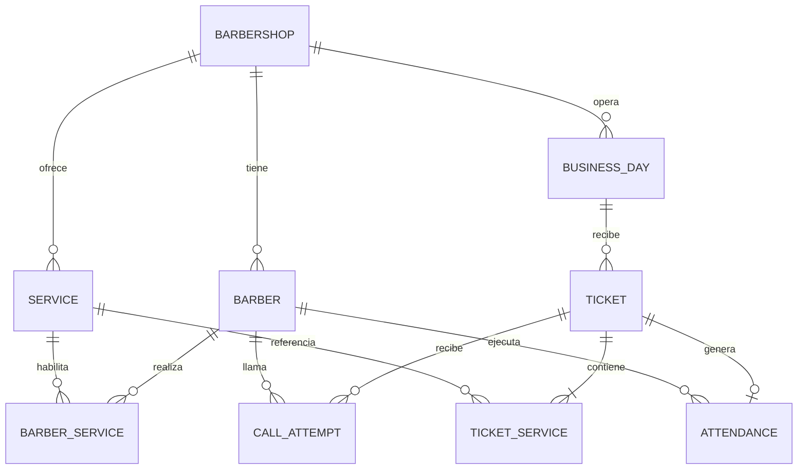
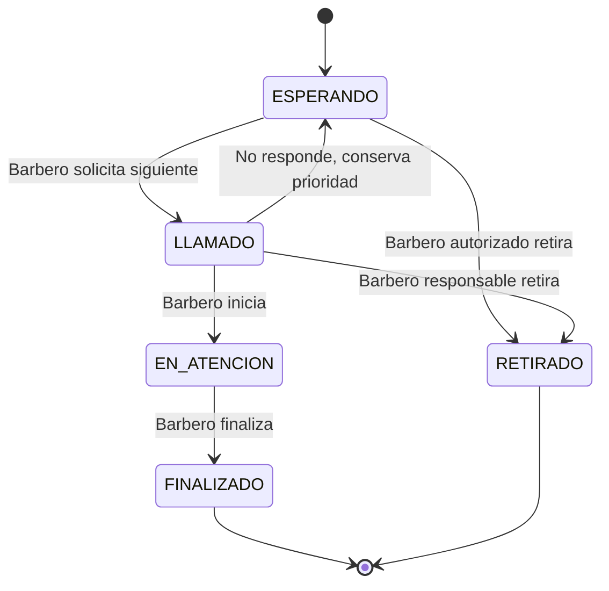

# Modelo de datos conceptual

Propuesta para una barbería. No es una migración SQL ni un esquema implementado. Los nombres técnicos son orientativos.

## Entidades

| Entidad | Campos principales | Función |
| --- | --- | --- |
| `barbershop` | id, nombre, timezone, moneda | Configuración y ámbito de aislamiento |
| `staff_membership` | id, auth_user_id, shop_id, role, enabled, barber_id opcional | Autorizar al personal; sin almacenar contraseñas propias |
| `barber` | id, shop_id, nombre_visible, enabled, accepts_new_tickets, version | Perfil y recepción de turnos; `enabled` no equivale a aceptar nuevos |
| `service` | id, shop_id, nombre, price, duration_minutes, active | Catálogo actual |
| `barber_service` | barber_id, service_id | Capacidad de realizar un servicio |
| `business_day` | id, shop_id, business_date, status, opened_at, closed_at, ticket_counter, priority_counter | Jornada y secuencias; fila central bajo bloqueo |
| `ticket` | id, shop_id, day_id, number, customer_name, preference, preferred_barber_id, priority_order, created_at, priority_changed_at, state, assigned_barber_id, version | Una persona, preferencia vigente y estado |
| `ticket_service` | id, ticket_id, service_id, name_snapshot, price_snapshot, duration_snapshot | Servicios contratados con valores históricos |
| `call_attempt` | id, ticket_id, barber_id, opportunity_id, called_at, result, resolved_at | Cada llamado reservado y su resultado: pendiente, inició, no respondió o retirado |
| `call_opportunity` | id, day_id, barber_id, opened_at, closed_at | Evitar relanzar al ausente dentro de la misma búsqueda |
| `opportunity_skip` | opportunity_id, ticket_id | Ausentes omitidos solo en esa oportunidad |
| `attendance` | id, ticket_id, barber_id, started_at, finished_at | Atención real; como máximo una por turno |
| `priority_exception` | id, day_id, ticket_id, barber_id, displaced_ticket_id, consent_recorded, reason, authorized_by, status, created_at, consumed_at | Excepción administrativa puntual propuesta |
| `audit_event` | id, shop_id, actor_type, actor_id, action, target_id, before, after, reason, created_at | Trazabilidad, con datos mínimos |
| `public_event` | seq, shop_id, day_id, type, ticket_number, barber_name, created_at | Eventos persistentes sanitizados para TV |
| `device` | id, shop_id, type, credential_hash, enabled, last_seen_at | Tablet o pantalla autorizada y revocable |
| `request_deduplication` | shop_id, actor_scope, operation, request_key, payload_hash, response_ref, created_at | Reintentos de una operación sin duplicarla |

`enabled` permite desactivar perfiles para futuro uso, pero no debe usarse para esconder compromisos pendientes. La disponibilidad operativa solo se cambia con `accepts_new_tickets`, por administrador. Fotografías de barberos son opcionales pendientes; no requieren almacenamiento adicional para la primera demo si se usan recursos ficticios locales.

## Relaciones principales

## Estados del turno

| Estado | Significado | Salida permitida |
| --- | --- | --- |
| `ESPERANDO` | Pendiente; puede tener intentos sin respuesta previos | `LLAMADO` o `RETIRADO` |
| `LLAMADO` | Reservado temporalmente por un barbero | `EN_ATENCION`, `ESPERANDO` por ausencia o `RETIRADO` por barbero autorizado |
| `EN_ATENCION` | Servicio iniciado manualmente | `FINALIZADO` |
| `FINALIZADO` | Atención concluida | Sin cambio operativo normal |
| `RETIRADO` | Sale de la fila por acción de barbero | Sin restauración automática |

Ausencia es resultado de un intento y no un estado terminal. `assigned_barber_id` es nulo en espera y en retiro; se establece al llamar y se conserva al finalizar para trazabilidad. El barbero real queda también en `attendance`. Un específico en espera usa `preferred_barber_id`; eso no lo convierte en una atención reservada.

Repetir el anuncio de un llamado crea un evento público nuevo asociado al intento existente; no crea otra reserva ni otro intento de selección.

La devolución de un llamado a espera para corregirlo por motivos distintos de ausencia necesita definir DP-05. No se implementa un cambio administrativo silencioso sobre una atención.

## Restricciones e índices propuestos

- ID de cada entidad y claves foráneas válidas, sin eliminación en cascada de historia de atenciones.
- Único `(shop_id, day_id, number)`; número legible propuesto `A-001`, manteniendo la fecha/jornada como parte de su identidad.
- Único `(day_id, priority_order)`, generado por contador transaccional; no usar la hora del celular para ordenar.
- Una sola jornada abierta por barbería mediante restricción apropiada.
- Índice único parcial por barbero asignado para estados `LLAMADO`/`EN_ATENCION`; un turno tiene una única asignación activa.
- Una `attendance` por `ticket_id`, con fin posterior o igual a inicio; nunca finalizar sin iniciar.
- `ANY` exige `preferred_barber_id = null`; `SPECIFIC` exige barbero específico.
- Importe `numeric(10,2)` no negativo; duración entera positiva. No usar punto flotante binario para dinero.
- Sin servicios duplicados en un turno ni capacidades duplicadas en la matriz.
- Una clave de idempotencia única por ámbito de actor/operación; mismo ID con distinto contenido devuelve conflicto.
- Índices de candidatos por jornada/estado/prioridad/preferencia y específico; auditoría/eventos por ámbito y secuencia.
- Validez de capacidades y permisos se comprueba dentro de la transacción; no todo puede expresarse con una clave foránea.

La forma concreta del bloqueo se basa en [PostgreSQL](https://www.postgresql.org/docs/current/explicit-locking.html). Elegirlo e implementarlo antes de optimizar consultas para garantizar que dos dispositivos no consuman el mismo turno.

## Integridad histórica

Las líneas guardan nombre, precio y duración en el momento del registro; un cambio de catálogo no reescribe el turno. Una corrección autorizada de servicios pendientes guarda la versión anterior/nueva y vuelve a calcular snapshots afectados. Una atención finalizada no cambia de barbero, precio ni estado desde formularios normales.

No se eliminan servicios/barberos referenciados: se desactivan cuando no generen conflictos con pendientes. El historial no conserva contraseñas, cookies, claves ni números de contacto innecesarios.

## Cálculos de reportes

- Personas atendidas: cantidad de turnos `FINALIZADO`.
- Servicios realizados: cantidad de líneas de esos turnos.
- Valor realizado: suma exacta de `price_snapshot` de esas líneas.
- Por barbero: agrupar por `attendance.barber_id`, no por preferencia original.
- Duración real: diferencia entre fin e inicio, independiente de la duración configurada.
- Espera real: inicio menos creación; conservar también cambios de prioridad para explicar la experiencia.
- Reporte diario principal: por `business_day`. Si se habilita filtro por fecha/hora de finalización, rotularlo expresamente y convertir límites locales a UTC; no mezclar ambos criterios.

No hay tabla de pagos, gastos o comisiones en este alcance. Por tanto, no se calcula caja ni utilidad neta.
